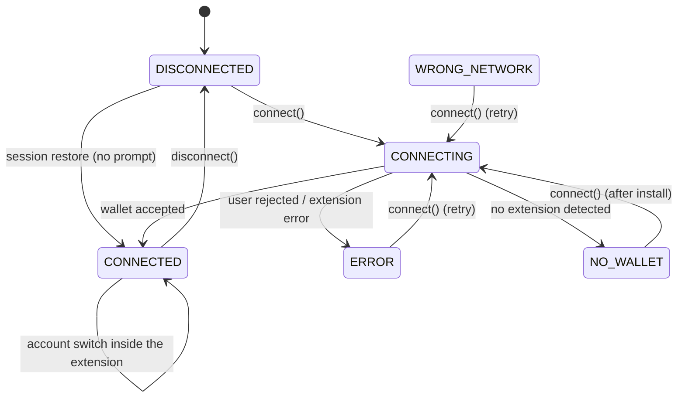

# Wallet Developer Guide

The LiquiFact frontend has one wallet layer: a Freighter adapter, a pure state
machine, and a React context that the header button reads. This guide
describes the code that actually ships.

---

## Files

| File | Kind | What it does |
|---|---|---|
| `lib/stellar/walletState.js` | plain ESM | The wallet state machine. No React, no Freighter imports, so it is unit testable with `node:test`. |
| `lib/stellar/freighter.js` | plain ESM | The adapter around `@stellar/freighter-api`. Normalises every failure into a `WalletError` with a stable `code`. |
| `components/wallet/WalletProvider.jsx` | client component | Owns the state, the session restore, the account watcher and the `useWallet()` context. |
| `components/wallet/WalletButton.jsx` | client component | The header button: connect, spinner, connected menu, install link, error banner. |
| `components/SiteHeader.jsx` | client component | Renders `<WalletButton />` inside the navigation, so it sits after the links on desktop and inside the mobile drawer. |
| `app/layout.js` | server component | Mounts `<WalletProvider>` around the header, the page and the footer. |

```
app/layout.js
└── <WalletProvider>            ← single source of truth, mounted once
    ├── <SiteHeader>
    │   └── <nav>
    │       └── <WalletButton>  ← the only consumer today
    ├── <main>{children}</main>
    └── <SiteFooter>
```

---

## State Machine

### States

| State | Value | Description |
|---|---|---|
| `DISCONNECTED` | `"disconnected"` | Initial state; no wallet is connected. |
| `CONNECTING` | `"connecting"` | A connection attempt is in progress; the UI is locked. |
| `CONNECTED` | `"connected"` | The wallet is connected. `address` and `network` are populated. |
| `ERROR` | `"error"` | The connection attempt failed (user rejection, extension error). |
| `WRONG_NETWORK` | `"wrong_network"` | The wallet is connected to the wrong Stellar network. |
| `NO_WALLET` | `"no_wallet"` | No Freighter extension was detected in the browser. |

`wrongNetwork` is also exposed as a boolean flag on the state, so the network
guard can raise it without changing the status. The guard itself is not wired
up yet — blocking transactions on a network mismatch is a separate issue.

### Transitions



The reducer lives in `lib/stellar/walletState.js` and is a pure function of
`(state, action)`:

```js
import { walletReducer, WALLET_ACTIONS } from "@/lib/stellar/walletState";

const next = walletReducer(state, {
  type: WALLET_ACTIONS.CONNECTED,
  address: "GABC…",
  network: "testnet",
});
```

Actions: `connect`, `connected`, `failed`, `no_wallet`, `account_changed`,
`network_changed`, `disconnect`.

---

## `useWallet()`

```js
import { useWallet } from "@/components/wallet/WalletProvider";

const { status, address, network, error, connect, disconnect } = useWallet();
```

| Field | Type | Description |
|---|---|---|
| `status` | `string` | One of the `WALLET_STATUS` values. |
| `address` | `string \| null` | The connected Stellar address. |
| `network` | `string \| null` | The network reported by the extension, e.g. `"testnet"`. |
| `networkPassphrase` | `string \| null` | The network passphrase reported by the extension. |
| `error` | `string \| null` | Human readable reason for the last failure. |
| `errorCode` | `string \| null` | Machine readable reason (`NO_WALLET`, `USER_REJECTED`, `UNKNOWN`). |
| `wrongNetwork` | `boolean` | True when the wallet is on the wrong network. |
| `connect()` | `() => Promise<{ status: string }>` | Starts a connection attempt. Never rejects — the outcome is in the resolved value and in the state. |
| `disconnect()` | `() => void` | Ends the session, stops the watcher and clears the session flag. |

The hook throws when it is used outside a `<WalletProvider>`.

---

## The Freighter adapter

`lib/stellar/freighter.js` is the only module that knows about Freighter. It
exposes:

| Function | Freighter call | Returns |
|---|---|---|
| `isAvailable()` | — (`window.freighter`) | `boolean` |
| `connect()` | `requestAccess()` | the selected address |
| `getAddress()` | `getAddress()` | the active address |
| `isAllowed()` | `isAllowed()` | `boolean` — is the site already trusted? |
| `getNetwork()` | `getNetworkDetails()` | `{ network, networkPassphrase }` |
| `signTransaction(xdr, options)` | `signTransaction(xdr, options)` | the signed XDR |
| `watch(callback)` | `new WatchWalletChanges()` | an unsubscribe function |

Freighter never throws for a rejected request — it resolves with
`{ error: { code, message } }`. The adapter normalises that once:

| Situation | `WalletError.code` |
|---|---|
| The extension is not installed | `NO_WALLET` |
| The user declined the request (extension code `4001` / `4100`) | `USER_REJECTED` |
| Anything else | `UNKNOWN` |

The extension is imported dynamically (`import("@stellar/freighter-api")`)
inside the adapter, so nothing touches `window` during server rendering. The
adapter is deliberately narrow (Freighter only) so that other wallets can be
added later behind the same interface.

---

## Session restore

On mount the provider checks two things:

1. the browser remembers a session — `localStorage["liquifact-wallet"] === "1"`;
2. the extension already trusts this site — `isAllowed()`.

Only then does it read the address again, **without** calling `requestAccess()`,
so a reload never shows a prompt. The flag is written on a successful connect
and cleared on disconnect or when the extension is gone.

The flag holds **no** address, no key and no other personal data — only the
fact that a session may be restored. No private key ever reaches the app: the
extension signs, the app only ever sees public addresses.

---

## Account changes

While the wallet is connected the provider subscribes with `watch()` and
dispatches `account_changed` when the extension reports a different address.
The subscription is torn down on unmount and on disconnect.

---

## Header button

`components/wallet/WalletButton.jsx` renders one of:

| State | Rendering |
|---|---|
| `disconnected` | a **Connect wallet** button |
| `connecting` | a disabled button with a spinner and `aria-busy="true"` |
| `connected` | the short address; clicking opens a menu with *Copy address*, *View on stellar.expert* and *Disconnect* |
| `no_wallet` | an **Install Freighter ↗** link to <https://www.freighter.app/> |
| `error` | the connect button plus an inline `role="alert"` message and a **Retry** button |

Accessibility notes:

* the connected trigger is a disclosure: `aria-expanded`, `aria-haspopup="menu"`
  and `aria-controls` point at the menu;
* **Escape** closes the menu and returns the focus to the trigger;
* every state change is announced through an `sr-only` `role="status"`
  `aria-live="polite"` region;
* the error message is an inline `role="alert"` region with a retry button;
* the button keeps the existing `:focus-visible` ring and works at 375px,
  where it moves into the mobile navigation drawer.

The explorer link is built from `EXPLORER_ACCOUNT_URL` in `lib/config.js`
(`/account/<G…>`), so it is not hard-coded to one network.

---

## Testing

| Test file | Runner | Focus |
|---|---|---|
| `tests/wallet-state.test.mjs` | `node:test` | Every reducer transition. |
| `tests/wallet-adapter.test.mjs` | `node:test` | The adapter: Freighter error payloads become typed `WalletError`s. |
| `tests/ui/wallet-button.ui.test.jsx` | Vitest + Testing Library | The button in every state, the menu actions, the session restore. |

```bash
npm test          # node:test — the pure logic
npm run test:ui   # vitest — the components
```

The adapter takes its Freighter API through `setFreighterApi()`, so the tests
never need the real extension and never touch `window`.

### Integration with current main

Availability uses the asynchronous Freighter SDK `isConnected()` result rather
than requiring a `window.freighter` global. The adapter also recognizes the
SEP-43 rejection code `-4`. Existing onboarding helper exports remain available;
`hasFreighter()` is now awaited by the checklist and shares the SDK detector.
Connection/restore attempts are invalidated by disconnect or unmount, and the
watcher updates context on network-only changes as well as account changes.
The current theme toggle, onboarding route, test setup, and pinned testing-tool
versions are retained. All UI tests use the existing `vitest.config.mjs`.
